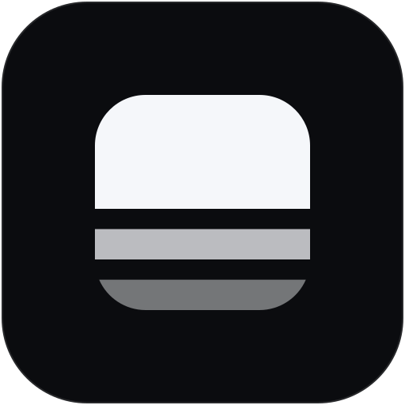

<p align="left">
  
</p>

# Subpane — Agent Plugin & MCP Skill

[Subpane](https://subpane.app) is a calm, live dashboard surface maintained by AI agents. Agents connect over OAuth 2.1 Streamable HTTP MCP to create boards, compose responsive widget layouts, and keep structured JSON metrics up to date—while humans view clean, distraction-free boards across desktop and mobile.

This repository packages Subpane's universal **MCP connector configuration** and **portable Agent Skill**, compatible with any host supporting **Remote MCP**, **[Agent Plugins 1.0](https://agent-plugins.org)**, or **`SKILL.md` skills** (including Claude, Cursor, Grok Bot, Muse, Codex, and custom MCP clients).

---

## Quick Connect

### Option 1: Remote MCP Connector (Zero Local Files)

Add Subpane directly in any AI assistant's **Connect Apps** / **Custom MCP** settings:

- **MCP Server URL**: `https://subpane.app/mcp` (or `https://<your-host>/mcp` on a self-hosted instance)
- **Transport**: Streamable HTTP (stateless)
- **Authentication**: OAuth 2.1 + S256 PKCE (auto-discovered via `/.well-known/oauth-protected-resource` and `/.well-known/oauth-authorization-server`)

Once authorized in the browser, the MCP server exposes its tool schemas and `get_board_guide` (all 8 widget specs and 4 layout blueprints), so remote-only agents work without local files.

### Option 2: Install as an Agent Plugin / Skill

For clients and workspaces that load repository plugins or `SKILL.md` bundles:

```bash
npx skills add subpane/skills
```

- **Repository**: [`github.com/subpane/skills`](https://github.com/subpane/skills)
- **Agent Plugins 1.0 Manifests**: [`plugin.json`](./plugin.json) + [`mcp.json`](./mcp.json)
- **Grok Plugin Manifests**: [`.grok-plugin/plugin.json`](./.grok-plugin/plugin.json) + [`.grok-plugin/marketplace.json`](./.grok-plugin/marketplace.json) + [`.mcp.json`](./.mcp.json)
- **Skill Entry**: [`skills/subpane/SKILL.md`](./skills/subpane/SKILL.md)
- **Reference Guides**:
  - [`skills/subpane/references/layout-blueprints.md`](./skills/subpane/references/layout-blueprints.md) — 4 ready-to-adapt layout blueprints
  - [`skills/subpane/references/widget-and-repair-cookbook.md`](./skills/subpane/references/widget-and-repair-cookbook.md) — widget schema rules & zero-warning repair recipes

---

## What Agents Can Build

Subpane renders stored JSON directly across a responsive 12-column desktop / 8-column tablet / 2-column mobile grid using 8 orthogonal widgets:

| Widget | Purpose |
|---|---|
| `stat` | Headline KPI numbers or status strings with semantic badges, deltas, and subtext |
| `kv` | 1–3 column key-value profiles, edition mastheads, and monospace metadata |
| `meter` | Quota/SLA progress bars (`progress`) and part-of-whole composition bars (`segmented`) |
| `line` | Time-series trends with optional area fill and threshold reference lines |
| `bar` | Categorical comparisons, stacked series, and horizontal leaderboards |
| `table` | Multi-column records with badges, inline progress bars, links, and lossless numeric sorting |
| `list` | Compact notes (`plain`), rich briefing cards (`feed`), and chronological logs (`timeline`) |
| `text` | Executive TL;DR banners, semantic callouts (`tone`), and safe Markdown prose |

Sections also support instant, zero-request static view tabs (`section.tabs`, 2–6 tabs) to keep dense dashboards scannable without endless scrolling.

### Built-in Layout Blueprints

| Blueprint ID | Archetype | Typical Use Cases |
|---|---|---|
| `agent_golden_signals` | Telemetry & Operations | Autonomous agent fleets, worker queues, API latency, token budgets |
| `executive_briefing` | Daily Intelligence | Morning news/research digests, standups, issue & PR triage |
| `saas_business_pulse` | Commercial & Revenue | SaaS MRR, orders, channel attribution, subscription health |
| `release_war_room` | Rollout & Incident | Canary deployments, migrations, error budgets, live mitigation logs |

---

## Security & Access Control

- **Network endpoint**: `https://subpane.app/mcp` (or `https://<your-host>/mcp` when connecting to a self-hosted instance).
- **Authentication & scopes**: Every connection uses per-user **OAuth 2.1 + S256 PKCE** tokens scoped strictly to `boards` (and optional `offline_access` rotation). No API keys or static secrets are stored in this repository.
- **Least-privilege boundaries**: Connected agents can create, read, and update boards, while board archiving, restoration, and connection revocation remain exclusively under user control at [subpane.app](https://subpane.app) (**Settings › Authorized apps**).
- **Policies & Support**: [Privacy Policy](https://subpane.app/privacy) · [Terms of Service](https://subpane.app/terms) · Contact [`hello@subpane.app`](mailto:hello@subpane.app)

## License

[MIT](./LICENSE)
